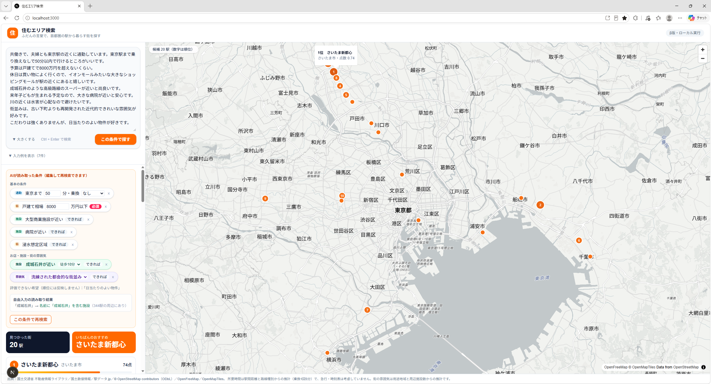
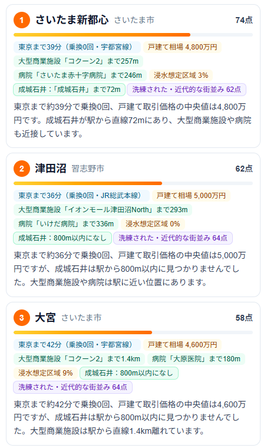
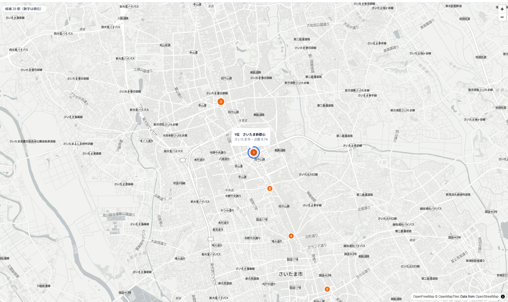
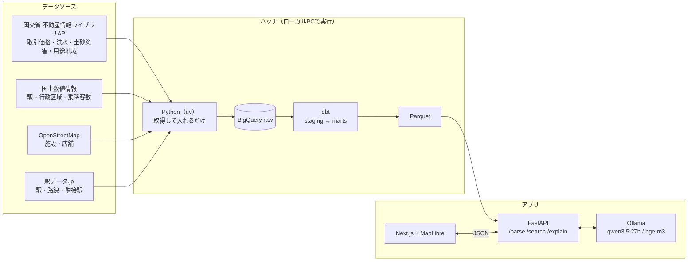
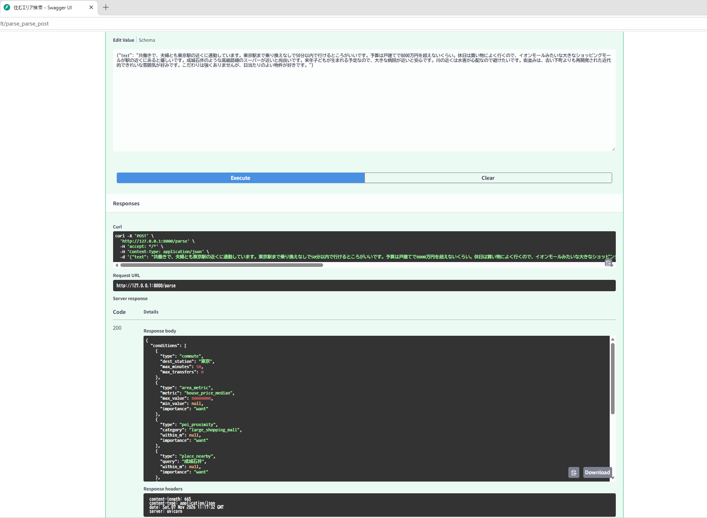
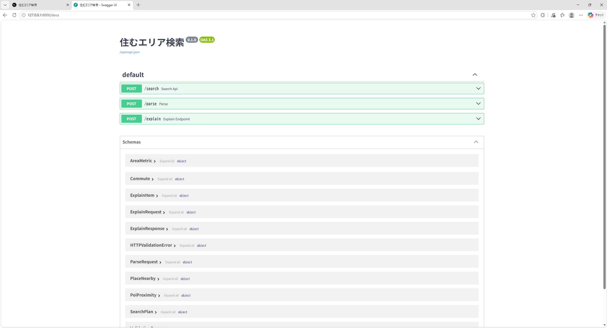

# 住むエリア検索（sumai-search）

**ふだんの言葉で書いた希望から、首都圏の駅を「根拠つき」でランキングする個人開発アプリです。**

> 「東京駅まで乗り換えなしで50分以内、戸建て8000万円まで、大きなショッピングモールと成城石井が近く、水害が心配、再開発された近代的な街並みがいい」
> → 条件を読み取り、乗り換えを考慮した所要時間・相場・災害リスク・周辺施設・街の雰囲気から駅を順位づけし、地図と説明文で根拠を示します。


https://github.com/user-attachments/assets/750f253d-7389-4592-af72-f7aa6fe8660d




※ LLMはローカル（Ollama）で動かしているため、実際は条件の読み取りと説明文の生成に数秒〜数十秒かかります。動画では待ち時間をカットしています。

---

## 画面

| AIが読み取った条件 | 1駅分の根拠と説明文 |
|---|---|
|  |  |
| 自由な文章を、決まった5種類の条件に変換します。変換できない希望（例：日当たり）は捨てずに「評価できない希望」として表示します。 | 所要時間・乗り換え回数・相場・店舗までの距離などの根拠を表示します。説明文の数字はすべて根拠データと照合済みです。 |



地図上の順位ピンをクリックするとリストと連動します。ホバーすると駅名とスコアが出ます。


## 動作環境（検証環境）

| 項目 | 内容 |
|---|---|
| OS | Windows 11 Home |
| CPU | AMD Ryzen 7 9800X3D（8コア） |
| メモリ | 64GB |
| GPU | NVIDIA GeForce RTX 5080（VRAM 16GB） |
| LLM | Ollama / qwen3.5:27b（約17GB。VRAMに載りきらない分はCPUで計算） |

## アーキテクチャ



検索1回の流れは次のとおりです。

1. `/parse`：LLMが文章を、カタログに定義された条件（JSON）に変換する。**順位は決めない**
2. `/search`：pandasと乗換グラフで絞り込みとスコア計算をする。**順位は数式で決める**
3. `/explain`：LLMが根拠データから説明文を書き、数字が根拠と一致するかを検査する

GCPのリソース（BigQueryデータセット、GCSバケット）はTerraformで管理しています。

---

## 設計で工夫した点

### 1. LLMに順位を決めさせない
LLMの役割は「文章 → 型の決まったJSON」への翻訳だけにしました。順位は数式で決めるので、同じ条件なら毎回同じ結果になり、なぜその順位なのかを説明できます。条件の型はPydanticの判別共用体（`type` で5種類を区別）で定義し、同じ定義から「LLMの構造化出力」と「APIの仕様書（Swagger）」の両方を自動生成しています。

### 2. できないことを正直に扱う
カタログにない希望（例：「日当たりのいい物件」）は、勝手に解釈せず `unsupported` に入れて画面に表示します。内容はログ（`logs/unsupported.jsonl`）にも残すので、「次にどんなデータを足すべきか」を判断する材料になります。

### 3. 説明文の数字を検査する
LLMが書いた説明文に、根拠データにない数字が含まれていたら、その文章は捨てて定型文に切り替えます。もっともらしい嘘の数字を出さないための安全装置です。

### 4. LLMは評価セットで選んだ
20問の評価セット（長文・複合条件を含む）を作り、ローカルで動く4モデルを比較しました。

| モデル | 正解数（20問） | 平均応答時間 |
|---|---|---|
| gpt-oss:20b | 12 | 20s |
| qwen3:14b | 15 | 20s |
| qwen3:30b-a3b | 18 | 25s |
| **qwen3.5:27b（採用）** | 20 | 30s|

評価の過程で「必須項目 `type` の書き忘れ」や「頼んでいない条件の水増し」という失敗パターンが見つかり、スキーマとプロンプトを修正しました。

### 5. 乗り換えを考慮した所要時間
「駅×路線」をノードにした乗換グラフを作りました（隣の駅への移動と、同じ駅での乗り換え5分を辺にしています）。目的地の駅から**逆向きにダイクストラ法**で探索し、乗り換え回数を状態に持たせることで、「乗り換え1回以内で45分」のような条件を1回の探索で全駅分計算します。結果は `lru_cache` でキャッシュしています。

### 6. どんな希望にもなるべく答える（3段構え）
- **店名**（成城石井、オーケーなど）：OSMの `brand` タグとの一致で探す
- **施設の種類**（温泉、図書館など）：多言語の埋め込みモデル（bge-m3）で、OSMのカテゴリとの意味の近さで探す
- **雰囲気**（静かな街、近代的など）：用途地域の割合と周辺の施設数から、説明できる特徴量でスコア化する（ブラックボックスにしない）

### 7. データの信頼性を明示する
取引件数が5件未満の駅は、相場を「不明」にしています（`price_reliable` フラグ）。少ない件数の中央値が、実際の相場とかけ離れることを確認したためです。

### 8. 検索時にはクラウドを呼ばない
dbtで作った集計表をParquetに書き出し、APIの起動時にメモリへ読み込みます。検索のたびにBigQueryを呼ばないので、1回あたりの費用はかからず、応答も速くなります。取得処理はタイルごとにキャッシュし、何度実行しても重複しない（冪等な）作りにしています。

---

## 技術スタックと選定理由

| 領域 | 技術 | 選んだ理由 |
|---|---|---|
| 取得バッチ | Python / uv | 依存関係をロックファイルで固定でき、別のPCでも同じ環境を再現できる |
| DWH | BigQuery | 地理空間関数（`ST_DWITHIN` など）で「駅から800m以内」のような集計をSQLで書ける。無料枠で収まる |
| 変換 | dbt | SQLをモデル単位で管理し、raw → staging → marts の層と依存関係を明確にできる |
| インフラ | Terraform | GCPのリソースをコードで管理し、作り直しを簡単にする |
| API | FastAPI / Pydantic | 型定義からJSON Schemaとドキュメントが自動で作られ、LLMの出力検証にもそのまま使える |
| LLM | Ollama（qwen3.5:27b） | ローカルで無料。評価セットでの安定性で選んだ |
| 埋め込み | bge-m3 | 日本語を含む多言語に対応し、ローカルで動く |
| 画面 | Next.js / TypeScript / Tailwind CSS | 型安全なReactで、APIのJSONの型を画面側でも共有できる |
| 地図 | MapLibre GL JS / OpenFreeMap | APIキー不要・無料で、ベクタータイルの地図を表示できる |

---

## 使用データ

| データ | 提供元 | 取得方法 | 主な項目 | アプリでの用途 |
|---|---|---|---|---|
| 不動産取引価格（XPT001） | 国土交通省 不動産情報ライブラリ | API（地図タイル単位、2022年第1四半期〜2025年第4四半期） | 取引価格、土地面積、延床面積 | 駅ごとの戸建て相場（中央値）、広い土地の割合 |
| 洪水浸水想定区域（XKT026） | 同上 | API（地図タイル単位） | 浸水深ランク | 駅から半径800m内の浸水想定区域の割合 |
| 土砂災害警戒区域（XKT029） | 同上 | API（地図タイル単位） | 警戒区域・特別警戒区域 | 駅から半径800m内の土砂災害リスク |
| 用途地域（XKT002） | 同上 | API（地図タイル単位） | 住居系・商業系などの区分 | 街の雰囲気（静か・都会的など）の指標 |
| 鉄道（駅）N02 | 国土数値情報 | GeoJSONをダウンロード | 駅名、路線名、位置 | 駅の基本の一覧（dim_stations） |
| 行政区域 N03 | 国土数値情報 | GeoJSONをダウンロード | 都県名、市区町村名 | 駅の所在地（市区町村）の表示 |
| 駅別乗降客数 S12 | 国土数値情報 | GeoJSONをダウンロード | 乗降客数 | 駅の規模の参考 |
| 駅・路線・接続 | 駅データ.jp（無料版） | CSVをダウンロード | 駅コード、路線、隣の駅 | 乗換グラフ（所要時間・乗換回数の計算） |
| 施設・店舗 | OpenStreetMap（Geofabrik 関東版） | PBFファイルをダウンロードし、osmiumで抽出 | 施設の種類、店名、ブランド | 公園・商業施設・病院・店名（成城石井など）の検索 |
| 背景地図 | OpenFreeMap / OpenMapTiles | 画面から直接読み込み | 地図タイル | 検索結果の地図表示 |

- 対象範囲は1都3県（東京・神奈川・埼玉・千葉）です。
- 取得したデータと、そこから加工したデータ（`data/`、`*.parquet`）はリポジトリに含めていません。再現する場合は、各提供元から取得してください（APIキーは `.env.example` を参照）。
- 所要時間は、駅間の距離と路線の種類から推計した値です（乗り換え1回につき5分を加算。急行や時刻表は考慮していません）。
- 相場は国の取引価格情報をもとにした目安で、売り出し中の物件や賃貸は含みません。

### 出典・ライセンス

- このサービスは、国土交通省不動産情報ライブラリのAPI機能を使用していますが、提供情報の最新性、正確性、完全性等が保証されたものではありません。
- 「国土数値情報（鉄道データ・行政区域データ・駅別乗降客数データ）」（国土交通省）を加工して作成
- 駅データ.jp（https://ekidata.jp/）
- © OpenStreetMap contributors（ODbL）
- 地図：OpenFreeMap © OpenMapTiles © OpenStreetMap contributors


## API

| エンドポイント | 入力 | 出力 |
|---|---|---|
| `POST /parse` | 文章 | 条件のJSON（`conditions` と `unsupported`） |
| `POST /search` | 条件のJSON | 駅のランキングと、条件ごとの根拠 |
| `POST /explain` | 条件と検索結果 | 上位駅の説明文（数字の検査つき） |



日本語の文章が、型の決まったJSONに変換されている例です。



FastAPIが自動生成するAPI仕様書（Swagger UI）です。

---

## ディレクトリ構成

```
sumai-search/
├── batch/        # 取得スクリプト（Python）
├── dbt/sumai/    # 変換（staging / marts）
├── api/          # FastAPI（parse / search / explain、乗換グラフ）
├── web/          # Next.js の画面
├── <<infra>>/    # Terraform
└── docs/images/  # READMEの画像
```

---

## 動かし方（概略）

データはライセンスの都合でリポジトリに含めていません。動かすには、不動産情報ライブラリのAPIキー、GCPプロジェクト、Ollamaが必要です。`.env.example` を `.env` にコピーして値を設定してください。

```powershell
# 1. データ取得 → BigQuery
uv run --project batch --env-file .env python -m batch.load_ksj
uv run --project batch --env-file .env python -m batch.fetch_reinfo_prices
uv run --project batch --env-file .env python -m batch.fetch_reinfo_hazard
# （そのほかの取得スクリプトも同様に実行）

# 2. 変換
cd dbt/sumai
dbt seed
dbt build

# 3. API
cd ../../api
uv run --env-file ../.env uvicorn main:app --reload

# 4. 画面（別のターミナルで）
cd web
npm install
npm run dev   # http://localhost:3000
```

---

## 制約と今後の拡張

| 現状の制約 | 拡張案 |
|---|---|
| 相場は戸建て（土地と建物）の取引価格のみ。マンション・賃貸は未対応 | 中古マンションは同じAPIで取得可能。賃貸は外部の物件データとの提携が必要 |
| 相場は公的な取引事例のため件数が少なく、売り出し中の物件は含まない | 物件ポータルのデータと組み合わせ、「エリア選び → 物件検索」へつなげる |
| 所要時間は駅間距離と路線種別からの推計。急行と時刻表は考慮していない | GTFSなどの時刻表データや、乗換案内APIで精度を上げる |
| OSMの施設カテゴリは主要なもののみ | カテゴリの追加と、施設の規模（面積など）の活用 |
| ローカル実行のみ | LLMを外部APIに置き換え、Cloud Runなどにデプロイする |
| テストとCIが未整備 | dbtテスト、評価セットの自動実行、GitHub Actions |

---

## データの出典とライセンス

- このサービスは、国土交通省の不動産情報ライブラリのAPI機能を使用していますが、提供情報の最新性、正確性、完全性等が保証されたものではありません。
- 国土数値情報（国土交通省）
- 駅データ.jp
- © OpenStreetMap contributors（ODbL）。OSM由来の加工データはリポジトリに含めていません
- 地図：OpenFreeMap / © OpenMapTiles

---

## 開発について

設計判断とデータの検証は自分で行い、コードの実装には生成AI（Claude）をペアプログラマーとして活用しました。
