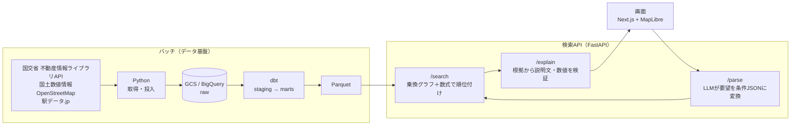

# 🏠 sumai-search — 自然言語で「住む街」を探す検索アプリ

「品川まで50分・乗り換え1回以内、戸建て8000万円以内で、大きなショッピングモールがある街」
のような普段の言葉の要望から、首都圏（1都3県）の駅を **根拠つきで** 順位づけする検索Webアプリです。


> ローカル環境で動作する個人開発のプロトタイプです。所要時間・相場はオープンデータからの推計値です。

## 背景と課題

物件サイトは「駅・沿線が決まっている人」向けに作られています。いっぽう、引っ越しの検討初期の
要望は「職場まで乗り換え1回」「水害が心配」「静かな街」といった **言葉の条件** です。
この「言葉の条件」と「駅を選ぶ作業」の間を埋めることを目指しました。

## スクリーンショット

| 検索結果 | 条件の解釈と修正 |
|---|---|
|  |  |

| 根拠と説明文 | API（FastAPI /docs） |
|---|---|
|  |  |

## アーキテクチャ



## 設計で工夫した点

### 1. LLMに順位を決めさせない3段構成
LLMに直接「おすすめの駅」を聞くと、もっともらしい誤り（ハルシネーション）が混ざり、結果も毎回変わり、
根拠も説明できません。そこでLLMの役割を **「要望の構造化（/parse）」と「根拠の説明（/explain）」** に限定し、
順位は数式（/search）で決めています。結果に再現性があり、ユーザーは条件チップで解釈を修正できます。

### 2. LLMの出力を型で縛る
検索条件は Pydantic の判別共用体（5種類：通勤・エリア指標・施設の種類・店名・街の雰囲気）で定義し、
JSONスキーマを指定した構造化出力でLLMに生成させています。カタログに無い要望は `unsupported` として
画面に「評価できない希望」と表示し、ログに残して次のデータ整備の材料にします。

### 3. 説明文の数字を自動で検証
LLMが書いた説明文に、根拠データに無い数字が1つでもあれば採用せず、定型文に切り替えます。

### 4. 乗り換えを考慮した所要時間
「駅×路線」をノード、同じ駅での路線の移動を乗り換えの辺としたグラフを作成しています。目的地から逆向きに
ダイクストラ法を1回実行するだけで、全駅について「〇分以内・乗り換え〇回以内」を判定できます。

### 5. 誤った数字を見せないデータ品質の判断
東京駅の戸建て相場が実態より大幅に安く出る異常に気づき、原因を調べました。取引件数の少なさによる
外れ値だったため、**取引が5件未満の駅は相場を表示しない** ようにし、信頼性フラグを付けています。

### 6. 評価にもとづくモデル選定
20問の評価セットで4種類のローカルLLMを比較し、正解率・安定性・速度から `qwen3.5:27b` を選びました。
評価の過程で「スキーマに初期値があるとLLMが `type` を省略する」「頼んでいない条件を足す」不具合を発見・修正しました。

### 7. コストと運用
BigQueryはバッチの加工だけに使い、検索はParquetをメモリ上で処理するため、検索ごとのクエリ料金はかかりません。
API取得はタイル単位でキャッシュして途中から再開でき、投入は何度やり直しても重複しません（冪等）。
インフラはTerraformで管理しています。

## 技術スタック

| 領域 | 技術 | 選定理由 |
|---|---|---|
| フロントエンド | Next.js / TypeScript / Tailwind CSS / MapLibre GL JS / OpenFreeMap | 型安全な画面と、APIキー不要・無料の地図 |
| バックエンド | FastAPI / Pydantic / pandas | 型によるLLM出力の検証と、自動生成のAPIドキュメント |
| LLM | Ollama（qwen3.5:27b、bge-m3） | 無料で反復評価できる。日本語と英語タグをつなぐ多言語埋め込み |
| データ基盤 | Python / GCS / BigQuery / dbt | 地理空間関数、SQLのバージョン管理、raw / staging / marts の層管理 |
| インフラ | Terraform / uv | インフラと依存関係を再現できる |

## ディレクトリ構成

```
sumai-search/
├── batch/       # データ取得・投入（Python）
├── dbt/sumai/   # データ加工（staging / marts）
├── terraform/   # GCPリソース（GCS / BigQuery）  ← 実際のフォルダ名に合わせる
├── api/         # 検索API（FastAPI）・LLM連携・評価スクリプト
├── web/         # 画面（Next.js）
└── docs/        # README用の画像
```

## 動かし方（概要）

データの取得にはGCPプロジェクトと不動産情報ライブラリのAPIキーが必要です。
取得したデータ・加工済みデータはライセンスの都合上リポジトリに含めていません。

1. `.env.example` をコピーして `.env` を作成し、値を設定
2. `terraform apply` でGCS・BigQueryを作成
3. `batch` のスクリプトでデータを取得し、`dbt build` で加工、Parquetに書き出し
4. Ollamaで `qwen3.5:27b` と `bge-m3` を取得
5. `cd api && uv run --env-file ../.env uvicorn main:app`
6. `cd web && npm install && npm run dev` → http://localhost:3000

## 現状の制約と拡張案

| 現状の制約 | 拡張案 |
|---|---|
| 相場は戸建ての取引価格のみ | 中古マンション・賃料データの追加 |
| 所要時間は駅間距離からの推計（急行・待ち時間は考慮していない） | 時刻表つきの乗換APIの結果をバッチでキャッシュ |
| 施設データはOSMの登録状況に依存 | 店舗データの拡充、治安・学区などのオープンデータの追加 |
| ローカル環境・ローカルLLM | 商用LLM APIへの切り替え、クラウドへのデプロイ、評価の自動化（CI） |

## 開発の進め方

生成AI（Claude）をペアプログラマとして活用しました。要件の整理、設計判断、データの妥当性の検証、
LLMの評価は自分で行い、実装はAIと対話しながら進めています。

## データ出典・ライセンス

- このサービスは、国土交通省不動産情報ライブラリのAPI機能を使用していますが、提供情報の最新性、正確性、完全性等が保証されたものではありません。
- 「国土数値情報（鉄道データ・行政区域データ・駅別乗降客数データ）」（国土交通省）を加工して作成
- 駅データ：駅データ.jp
- © OpenStreetMap contributors（ODbL）
- 地図：OpenFreeMap / © OpenMapTiles

コードは MIT License です。データは各提供元の利用規約に従ってください。
